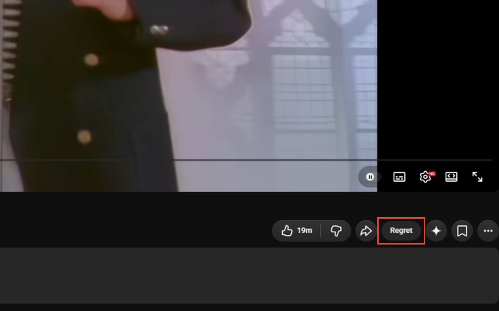
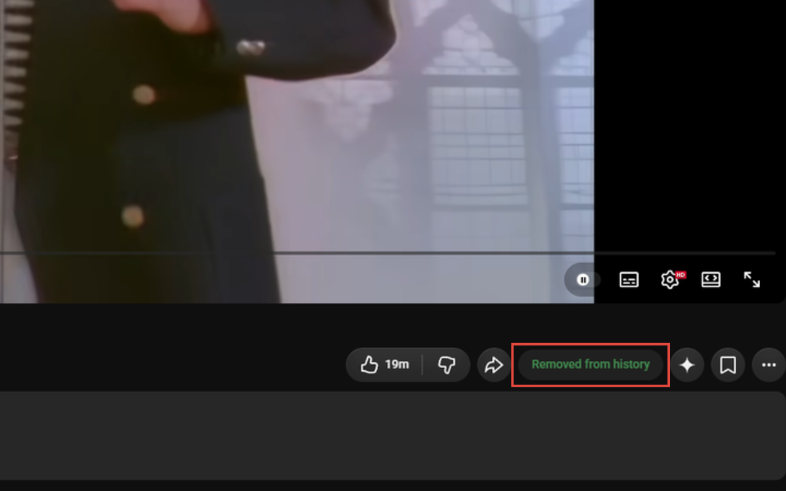
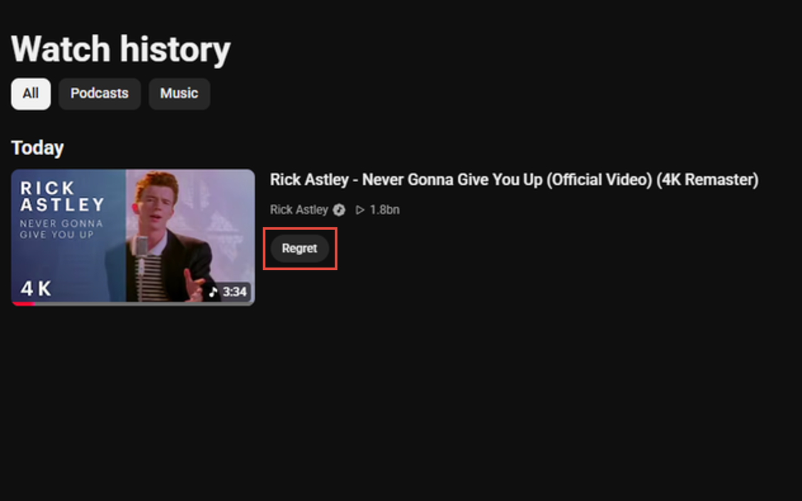
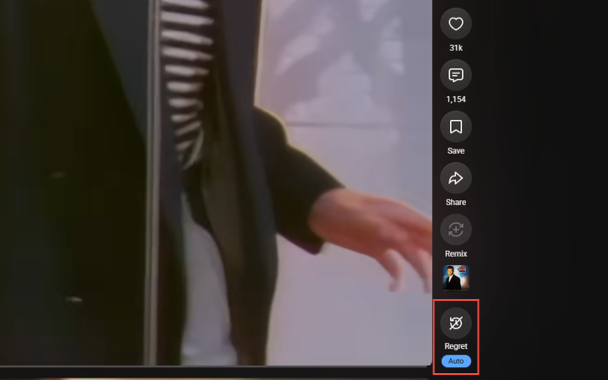
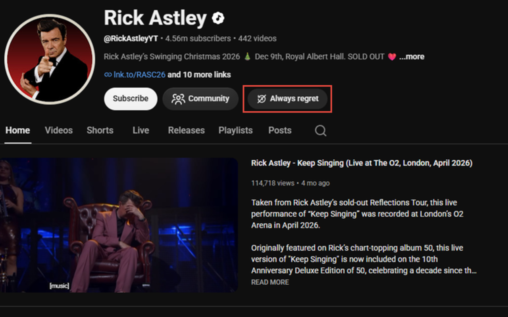
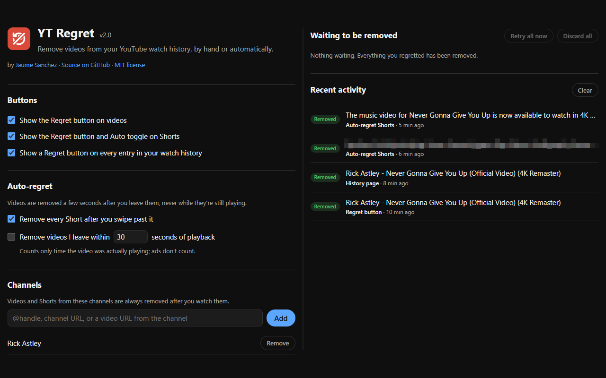

# YT Regret

**Take back control of your YouTube history.**

We've all been there. A guilty pleasure at 2am. A thumbnail that was too weird not to click. A clickbait title that turned out to be nothing. You watch it for thirty seconds, close it, and move on. YouTube doesn't move on: your home page fills up with more of the same for the next two weeks.

YT Regret lets you take those views back. One click removes a video from your watch history, so it stops steering your recommendations. You can also set rules to do it automatically, so the algorithm only learns from what you actually meant to watch.

## Features

- **Regret button** on every video and Short: removes it from your watch history on the spot.
- **Regret chips in your watch history**: clean up past mistakes without digging through menus.
- **Auto-regret rules**:
  - **Shorts**: every Short is removed after you swipe past it. Doomscroll without consequences.
  - **Channels**: mark a channel with **Always regret** on its page (or in the options), and its videos never stay in your history.
  - **Abandoned videos**: anything you leave within N seconds of playback is removed. Ads don't count. Clickbait you bailed on stays out of your history.
- **Reliable removals**: if YouTube hasn't recorded a view yet, or a request fails, the video is queued and retried with backoff for up to 3 days.
- **Options page**: toggle features, manage your channel list, see what's waiting to be removed, and check recent activity, including which rule removed each video.

## Screenshots

**One click on any video…**



**…and it's gone from your history.**



**Clean up past mistakes from your watch history.**



**Regret a Short, or turn on Auto to remove every Short you swipe past.**



**Always regret a channel, right from its page.**



**Rules, channels, and a log of what was removed and why.**



## Install

- **Chrome Web Store:** [YT Regret](https://chromewebstore.google.com/detail/cijjahokiojkmljkhgmhomabmecheodo)
- **From source:**
  1. Clone this repo.
  2. Open `chrome://extensions` and turn on **Developer mode**.
  3. Click **Load unpacked** and select the `extension` folder.

You need to be signed in to YouTube, since watch history belongs to your account.

## How it works

YouTube's public API has no access to watch history (Google removed it in 2016), so YT Regret does what YouTube's own history page does. It finds the video in your history and sends the same "Remove from watch history" request YouTube sends when you click ✕ there. Everything happens in your browser, signed in as you, on youtube.com.

- **Nothing leaves your browser.** No servers, no analytics, no tracking. The only requests go to youtube.com, for your own account.
- **Permissions:** access to `www.youtube.com` (to add the buttons and make the removal requests) and `storage` (to save your settings). Chrome shows the youtube.com access as "Read and change your data on www.youtube.com".
- Settings sync across devices signed into the same Chrome account. The removal queue stays in youtube.com's local storage in each browser.

## Good to know

- Removals only run while a YouTube tab is open. Anything still queued resumes the next time you open YouTube.
- After the extension updates or is reloaded, reload your open YouTube tabs. Until then they keep running the old version, and the options page can't see their queue.
- YouTube changes its page layout from time to time. If a button stops showing up, that's the likely cause, so please open an issue.

## Development

```
extension/          the extension itself (load this folder unpacked)
  regret.js         runs in YouTube's page: buttons, watch tracking, rules, removal queue
  bridge.js         relays settings and the queue between the page and chrome.storage
  settings.js       default settings, shared by both scripts and the options page
  options.*         options page
  icons/            generated icons
tools/
  make-icons.cjs    renders the icons: npm install && npm run icons
```

There's no build step. Edit the files, then reload the extension in `chrome://extensions`, and reload your YouTube tabs as well.

## License

[MIT](LICENSE)
